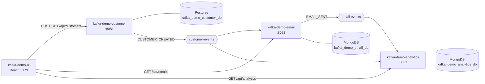

# Architecture

## The Kafka Demo system

| Repo | Role | Port | Data store |
|---|---|---|---|
| kafka-demo-customer | Owns customers, publishes `customer-events` | 8081 | Postgres |
| kafka-demo-email | Sends a welcome email per new customer, publishes `email-events` | 8082 | MongoDB |
| kafka-demo-analytics | Counts every event on `customer-events` and `email-events` | 8083 | MongoDB |
| kafka-demo-ui | React UI over all three | 5173 | — |
| local-docker | Kafka, Postgres, MongoDB for local dev | — | — |

## This service: kafka-demo-email

Listens to `customer-events`, sends a welcome email for each `CUSTOMER_CREATED`, stores it in MongoDB, and publishes `EMAIL_SENT` to `email-events`.

- **Produces:** `email-events` (`EMAIL_SENT`)
- **Consumes:** `customer-events` (group `kafka-demo-email`)
- **Stores:** MongoDB

## Design decisions

- **Idempotent on `eventId`.** The `email` collection has a unique index on `sourceEventId`, and
  `WelcomeEmailService` skips events it has already handled.
- **Sending is a stub.** `LoggingEmailSender` just logs. Swap in an SMTP/SES implementation of
  `EmailSender` to send for real.
- **Retries then DLQ.** `AppConfig.kafkaErrorHandler` retries 3× (1 s apart), then publishes to
  `customer-events-dlq`. Bad JSON goes straight to the DLQ.
- **`EMAIL_SENT` is published synchronously** so a Kafka failure fails the record and it is retried.

## Known gaps

- The email is saved before `EMAIL_SENT` is published; if publishing keeps failing the record goes
  to the DLQ and, on replay, is skipped as a duplicate without publishing. An outbox would close this.
- No Testcontainers integration tests yet.
