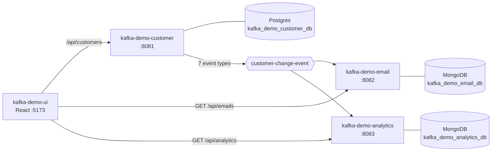

# Architecture

## The Kafka Demo system

| Repo | Role | Port | Data store |
|---|---|---|---|
| kafka-demo-customer | Owns customers and phones, publishes `customer-change-event` | 8081 | Postgres |
| kafka-demo-email | Sends an email for each customer change | 8082 | MongoDB |
| kafka-demo-analytics | Saves every event on `customer-change-event` | 8083 | MongoDB |
| kafka-demo-ui | React UI over all three | 5173 | — |
| local-docker | Kafka, Postgres, MongoDB, Keycloak for local dev | — | — |

## This service: kafka-demo-email

Listens to `customer-change-event`, saves each incoming event in MongoDB, skips any it has already processed, and sends the matching email: a welcome, a change notice, or a removal notice.

- **Produces:** —
- **Consumes:** `customer-change-event` (group `kafka-demo-email`)
- **Stores:** MongoDB

## Design decisions

- **Idempotent on `eventId`.** Each event is saved in `incoming_event` as `RECEIVED` before sending and set to
  `PROCESSED` afterwards, and only `PROCESSED` events are skipped, so a failed send is retried. The `email` collection
  also has a unique index on `sourceEventId`, and `CustomerChangeEmailService` checks it before sending, so a crash
  after the email is stored doesn't send it again.
- **`lastName` and `state` are copied onto each email**, because this service can't look up a customer and the list
  has to filter by them.
- **Sending is a stub.** `LoggingEmailSender` just logs. Swap in an SMTP/SES implementation of
  `EmailSender` to send for real.
- **Retries then DLQ.** `AppConfig.kafkaErrorHandler` retries 3× (1 s apart), then publishes to
  `customer-change-event-dlq`. Bad JSON and missing fields go straight to the DLQ.

## Known gaps

- A crash after sending but before the email is stored sends it again on redelivery.
- Emails stored before this version have no `lastName` or `state`, so filters leave them out.
